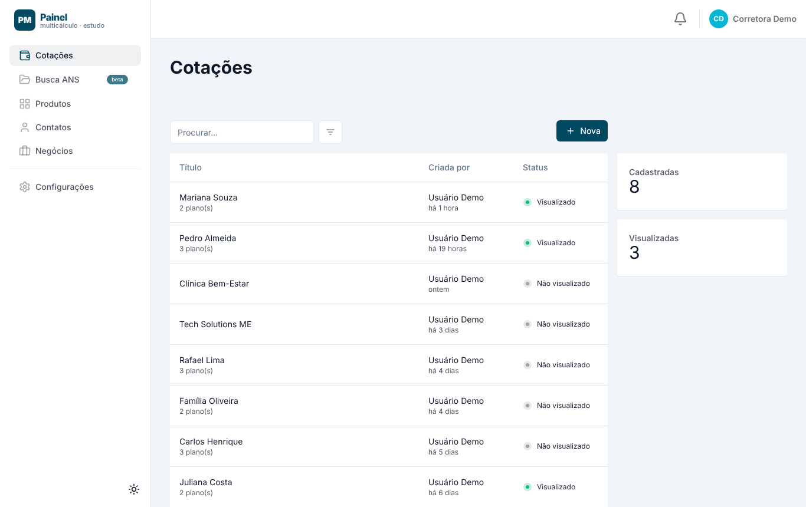
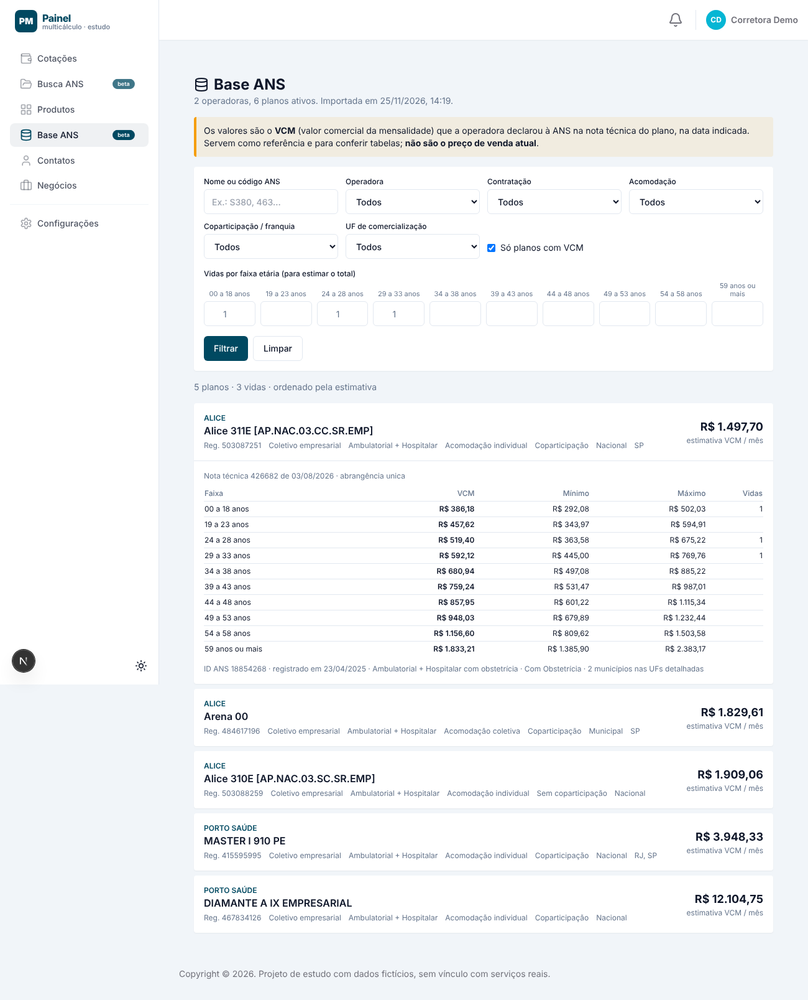

# Painel Multicálculo (estudo)

Recriação local, para estudo, das telas e fluxos de um painel de multicálculo de
planos de saúde para corretores. O levantamento do app de referência está em
[ANALISE.md](ANALISE.md).

> **Não é o serviço original.** Marca, operadoras, planos, preços, hospitais e
> índices são fictícios. Não há integração com nenhuma API real nem login.
> Use apenas localmente; não publique como se fosse o produto de referência.

## Rodar

Requer Node.js 20 ou mais novo.

```bash
cd studies/painel-corretor
npm install
npm run dev        # http://localhost:3000
```

Para produção local: `npm run build && npm start`.

Os dados ficam em `data/db.json`, criado na primeira requisição a partir de
`lib/seed.ts`. Para voltar ao estado inicial: `npm run reset-db`.

## O que funciona

| Tela | Rota | Comportamento |
| --- | --- | --- |
| Início | `/` | Saudação com o nome da corretora do perfil |
| Cotações | `/cotacoes` | Busca, filtro de período (7/30 dias/todo), paginação, status visualizado, cards de totais |
| Nova cotação | `/cotacoes/nova` | Cria a cotação e abre a distribuição de vidas |
| Editar cotação | `/cotacoes/[id]/edit` | Título editável, distribuição de vidas por faixa ANS ou por datas de nascimento coladas, seletor de planos (Saúde/Dental, PF/PME/Adesão, cidade, MEI, acomodação, coparticipação, contratação), filtros de perfil do cliente (econômico/intermediário/premium), faixa de valor e hospitais de preferência, cards com preço total, destacar ou remover plano, CNPJ com máscara, contato e negócio, linha do tempo, comparativo de rede; menu com Compartilhar (WhatsApp, e-mail, imprimir, link e copiar), Imprimir, Opções (validade, valores, rede, mais informações), Duplicar e Excluir |
| Proposta do cliente | `/cotacoes/[id]` e `/cotacoes/[id]/cenarios/[cenarioId]` | Página pública com preço por faixa, plano destacado como "Recomendado", respeita as Opções da cotação (oculta valores, rede ou detalhes; mostra "Proposta expirada" após a validade), "Tenho interesse" via WhatsApp, rede credenciada; cada abertura registra "Visualizada" (o link com `?preview=1`, usado pelo painel, não conta) |
| Busca ANS | `/busca-ans`, `/busca-ans/[registro]` | Com `data/ans/base.json` importado, usa os dados reais da ANS: filtros por nome/código, modalidade, UF, cidade, cobertura, acomodação e coparticipação; detalhe com VCM mínimo/mensalidade/máximo por faixa, abrangência e características. Sem a base, mostra os dados fictícios |
| Produtos | `/produtos`, `/produtos/[operadoraId]` | Grade de operadoras filtrada (inclui Aceita MEI e contratação opcional/compulsória); tabelas de preço em acordeão, rede, imprimir |
| Configurações | `/conta/*` | Perfil (foto, nome, telefone, mensagem padrão), Corretora (logo, cidade, redes sociais), Assinatura (licenças, faturas fictícias), Usuários (convite com limite de licenças, perfil, ativo/inativo), Equipes, Integrações (chave de API de estudo) e Preferências (operadoras habilitadas no seletor, "mais informações") |
| Tema | qualquer tela | Claro/escuro, salvo no navegador |

| Base ANS | `/base-ans` | Planos ativos das operadoras escolhidas com o VCM por faixa etária da ANS, filtros (operadora, contratação, acomodação, coparticipação, UF, município) e estimativa pelo número de vidas em cada faixa |

Contatos e Negócios (CRM, que no Painel é outro sistema com login próprio), notificações push,
o assistente de IA (só o botão) e o login são apenas indicados, não recriados. Fotos e logos
são só pré-visualizadas no navegador, sem gravar.

## Base ANS (dados reais e públicos)

A tela **Base ANS** usa os [dados abertos da ANS](https://dadosabertos.ans.gov.br/FTP/PDA/),
importados por `scripts/importar-ans.mjs`. Sem opções extras, importa as operadoras listadas em
[`data/ans/operadoras-alvo.json`](data/ans/operadoras-alvo.json) (hoje Amil, Bradesco Saúde,
SulAmérica, Porto Saúde, Alice e Hapvida NotreDame, por registro ANS); para incluir outra,
acrescente o registro ANS dela nesse arquivo. Com `--todas`, importa todas as operadoras ativas
que têm plano ativo vendido nas UFs de `--uf` (além das alvo).

```bash
npm run importar-ans -- --uf SP,MG --todas   # recomendado: todas as operadoras de SP e MG
npm run importar-ans -- --uf SP,MG           # só as operadoras alvo
npm run importar-ans -- --uf SP --sem-rede   # pula a rede hospitalar
npm run importar-ans -- --sem-area           # mais rápido: pula a área de comercialização (sem --todas)
npm run importar-ans -- --fonte C:\pasta\pda # usa cópias locais, na mesma estrutura de pastas da PDA
npm run baixar-logos                         # ícones dos sites oficiais em public/logos/<registro>.png
```

A importação baixa cerca de 1,2 GB (a área de comercialização sozinha tem ~1 GB), mais a parte da
rede hospitalar das UFs pedidas: o zip da rede tem 2,3 GB, mas o importador lê só o índice dele e
baixa apenas os CSVs das UFs de `--uf` (requisições HTTP Range). Grava em `data/ans/` os arquivos
`base.json`, `rede.json` e `indicadores.json`, que não vão para o Git. Rode de novo quando quiser
atualizar; a ANS publica a base de produtos diariamente e o VCM a cada nova nota técnica.
`--todas` sem `--uf` traz todas as operadoras do país (base muito grande) e não lê a rede.

| Arquivo da ANS | O que vira |
| --- | --- |
| `operadoras_de_plano_de_saude_ativas/Relatorio_cadop.csv` | Operadoras (CNPJ, razão social, modalidade) |
| `caracteristicas_produtos_saude_suplementar-008/…csv` | Planos com situação "Ativo": contratação, segmentação, abrangência, acomodação, coparticipação |
| `nota_tecnica_ntrp_vcm_faixa_etaria/…zip` | VCM, mínimo e máximo nas 10 faixas, da nota técnica mais recente de cada plano |
| `area_comercializacao_planos_ntrp/…csv` | UFs onde cada plano é vendido e, nas UFs pedidas com `--uf`, os municípios |
| `produtos_e_prestadores_hospitalares/…zip` | `rede.json`: hospitais (CNES, nome, município, classe, urgência) com vínculo ativo, por plano, nas UFs de `--uf` |
| `historico_idss-020/…csv` | `indicadores.json`: IDSS mais recente publicado de cada operadora |
| `percentuais_de_reajuste_de_agrupamento-055/…csv` | `indicadores.json`: reajuste do agrupamento de contratos nos dois ciclos mais recentes |

Os logos vêm de [`data/ans/logos.json`](data/ans/logos.json) (registro ANS → domínio oficial):
`npm run baixar-logos` baixa o ícone de cada domínio. São marcas de terceiros e ficam fora do Git.

> **VCM não é preço de venda.** É o valor comercial que a operadora declarou à
> ANS na nota técnica do plano, com faixa permitida de mínimo e máximo. Serve
> para estimar e conferir; a cotação final usa a tabela de venda da operadora.

## Estrutura

```
app/
  (dashboard)/          telas com barra lateral (layout.tsx = Sidebar + TopNav)
  cotacoes/[id]/        proposta pública, sem barra lateral
  actions.ts            server actions (mesmos nomes vistos no bundle de referência)
components/             UI no estilo shadcn/ui e componentes de cada tela
lib/
  types.ts              modelo de dados e as 10 faixas etárias da ANS
  seed.ts               gerador determinístico dos dados fictícios
  db.ts                 leitura/gravação de data/db.json
```

Stack: Next.js 15 (App Router, server actions), React 19, Tailwind CSS 3 com os
mesmos tokens de cor do app de referência, ícones lucide-react.

## Telas





