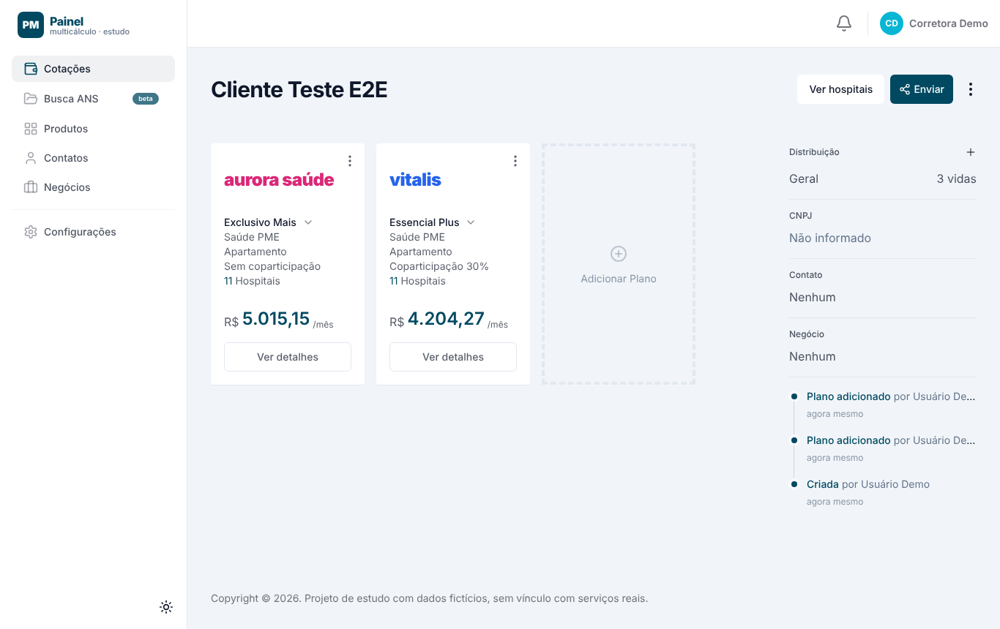
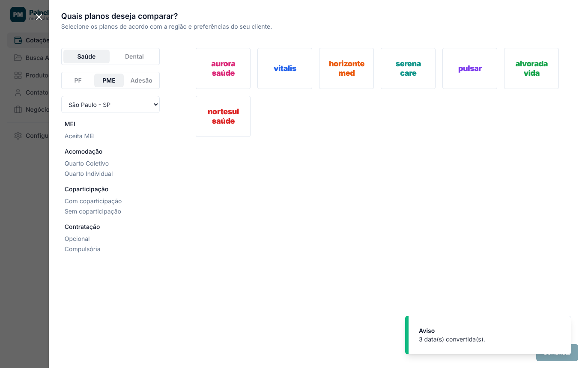
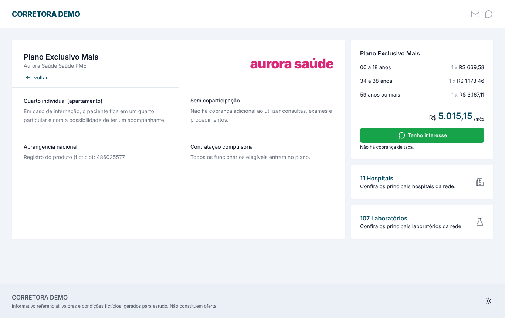

# Painel Multicálculo (estudo)

Recriação local, para estudo, das telas e fluxos de um painel de multicálculo de
planos de saúde para corretores. O levantamento do app de referência está em
[ANALISE.md](ANALISE.md).

> **Não é o serviço original.** Marca, operadoras, planos, preços, hospitais e
> índices são fictícios. Não há integração com nenhuma API real nem login.
> Use apenas localmente; não publique como se fosse o produto de referência.

## Rodar

Requer Node.js 20 ou mais novo.

```bash
cd studies/painel-corretor
npm install
npm run dev        # http://localhost:3000
```

Para produção local: `npm run build && npm start`.

Os dados ficam em `data/db.json`, criado na primeira requisição a partir de
`lib/seed.ts`. Para voltar ao estado inicial: `npm run reset-db`.

## O que funciona

| Tela | Rota | Comportamento |
| --- | --- | --- |
| Início | `/` | Saudação com o nome da corretora do perfil |
| Cotações | `/cotacoes` | Busca, filtro de período (7/30 dias/todo), paginação, status visualizado, cards de totais |
| Nova cotação | `/cotacoes/nova` | Cria a cotação e abre a distribuição de vidas |
| Editar cotação | `/cotacoes/[id]/edit` | Título editável, distribuição de vidas por faixa ANS ou por datas de nascimento coladas, seletor de planos (Saúde/Dental, PF/PME/Adesão, cidade, MEI, acomodação, coparticipação, contratação), cards com preço total, remover plano, CNPJ com máscara, linha do tempo, comparativo de rede, enviar (copiar mensagem + link, WhatsApp), excluir |
| Proposta do cliente | `/cotacoes/[id]` e `/cotacoes/[id]/cenarios/[cenarioId]` | Página pública com preço por faixa, "Tenho interesse" via WhatsApp, rede credenciada; cada abertura registra "Visualizada" (o link com `?preview=1`, usado pelo painel, não conta) |
| Busca ANS | `/busca-ans`, `/busca-ans/[registro]` | Filtro por nome/código, modalidade, cidade e acomodação; detalhe com IDSS, reajuste, abas Preços/Abrangência/Rede |
| Produtos | `/produtos`, `/produtos/[operadoraId]` | Grade de operadoras filtrada; tabelas de preço em acordeão, rede, imprimir |
| Configurações | `/conta/perfil` | Nome, telefone e mensagem padrão (usada no "Enviar") |
| Tema | qualquer tela | Claro/escuro, salvo no navegador |

Contatos e Negócios (CRM), as demais seções de Configurações, notificações push,
assistente de IA e login são apenas indicados, não recriados.

## Estrutura

```
app/
  (dashboard)/          telas com barra lateral (layout.tsx = Sidebar + TopNav)
  cotacoes/[id]/        proposta pública, sem barra lateral
  actions.ts            server actions (mesmos nomes vistos no bundle de referência)
components/             UI no estilo shadcn/ui e componentes de cada tela
lib/
  types.ts              modelo de dados e as 10 faixas etárias da ANS
  seed.ts               gerador determinístico dos dados fictícios
  db.ts                 leitura/gravação de data/db.json
```

Stack: Next.js 15 (App Router, server actions), React 19, Tailwind CSS 3 com os
mesmos tokens de cor do app de referência, ícones lucide-react.

## Telas





